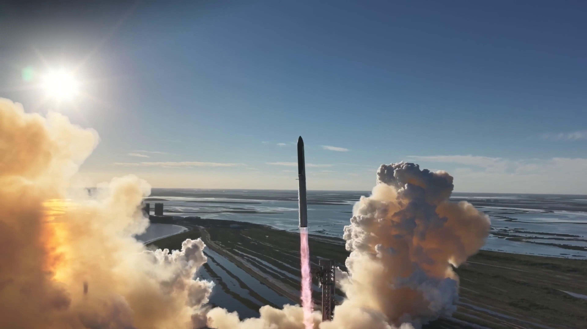

# Flight 15 for macOS

Watch Starship lift off, climb through the plume and return to the tower. Flight 15 brings all twelve scenes from [yamz8’s Omarchy theme](https://github.com/yamz8/omarchy-flight-15-theme) to the Mac. Each scene has a silent 4K intro that settles into its matching wallpaper. The included Terminal and iTerm2 profiles use the original Starship palette.

## Install

1. On a Mac running **macOS 13 Ventura or later**, extract the Flight 15 installer ZIP or download the full repository using **Code → Download ZIP**. The compact installer downloads about 325 MiB of media during installation and checks every file against its checksum. A full checkout or repository ZIP includes the media and works offline.
2. Open **Install Flight 15.command** in the extracted folder. You can also run `bash "./Install Flight 15.command"` from that folder in Terminal. The installer uses tools included with macOS to build **Flight 15.app** in your home **Applications** folder. It bundles the clips and converts the original WebP stills to lossless PNGs.
3. Choose a scene and click **Set Wallpaper**. Open **Flight 15** again from Spotlight or Finder to change it. The picker preselects the next scene in flight order and wraps from the tower catch back to ignition.

The clip plays behind your windows and desktop icons, then the app quits and macOS keeps the still. To see the whole scene, show your desktop. Uncheck **Play the matching intro** for an instant change. Flight 15 also follows **System Settings → Accessibility → Display → Reduce motion**.

The picker sets the wallpaper on the current desktop Space of each connected display. Open it in another Space to apply a scene there. For automatic rotation of the stills, click **Show Theme Files** and add its **Wallpapers** folder in **System Settings → Wallpaper**.

## Terminal and appearance

Click **Show Theme Files** in the picker, then open **Profiles**. The same two files are also in [macos/Profiles](macos/Profiles).

- **Terminal** — Open **Flight 15.terminal** to try the profile in a new window. To use it for new sessions, select **Flight 15** in **Terminal → Settings → Profiles** and click **Default**.
- **iTerm2** — In **Settings → Profiles → Colors → Color Presets**, choose **Import**, select **Flight 15.itermcolors**, then choose **Flight 15** from the presets.
- **macOS controls** — For matching window and menu colors, choose **Dark** appearance and the **Orange** accent in **System Settings → Appearance**.

Explore all twelve scenes

| # | Background | Shot |
| --- | --- | --- |
| 01 | `01-pad-ignition-ground` | Steam builds, the engines ignite, and the fire grows under the full stack on the pad |
| 02 | `02-pad-aerial-plume` | High aerial, the plume blows out across the pad |
| 03 | `03-liftoff-past-tower` | The rocket rises past the tower |
| 04 | `04-wide-reflection-water` | Wide across the water, tower and rocket reflected |
| 05 | `05-top-down-exhaust` | Straight down from the tower into the exhaust |
| 06 | `06-golden-hour-climb` | Golden hour, climbing out of the steam |
| 07 | `07-aerial-climb-blue-sky` | Aerial chase into blue sky |
| 08 | `08-onboard-ship-looking-down` | Onboard Ship 42, looking down at the pad |
| 09 | `09-onboard-flip-over-starbase` | The next day: riding on Ship 42 down through the clouds and into the flip over Starbase |
| 10 | `10-landing-burn-beside-tower` | Ship 42 comes home on its engines and stops beside the tower |
| 11 | `11-into-the-chopsticks` | From the tower: Ship 42 comes down into the chopsticks on its engines |
| 12 | `12-caught-at-the-tower` | Ship 42 held by the tower's chopsticks (slowed 1.5x) |

## Remove or update

To remove the app, choose another wallpaper in System Settings, then move `~/Applications/Flight 15.app` to the Trash. You can remove imported terminal profiles separately in the terminal app’s settings. To update, run the installer from the newer copy of the theme.

## Credits

The scene selection, video edits and matching stills are by **yamz8**. The underlying SpaceX footage remains subject to SpaceX’s rights. See [NOTICE.md](NOTICE.md) for sources and editing details. The Starship palette comes from [Omarchy](https://github.com/omacom/omarchy) under its MIT license. The macOS scripts and profile generation code use the repository’s [MIT license](LICENSE).
